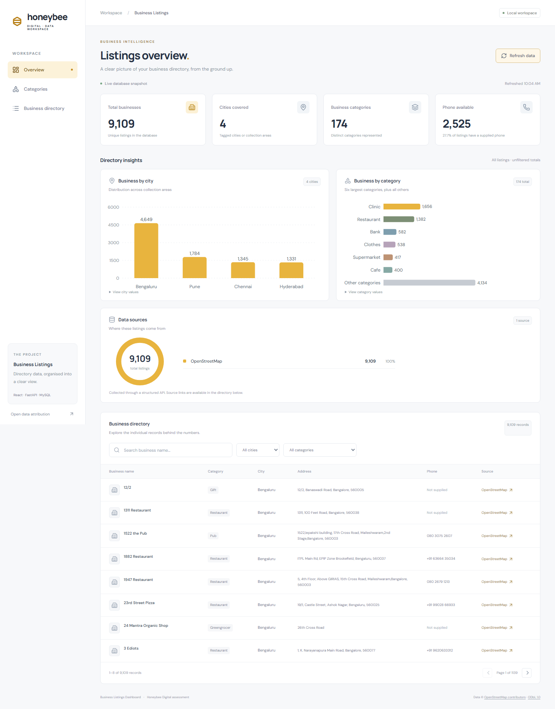

# Business Listings Dashboard

A working Honey Bee Digital internship assessment built with **React, FastAPI and MySQL**. It turns a reproducible OpenStreetMap POI dataset into city, category and source analytics, with a searchable directory of the underlying businesses.

**Verified snapshot, 13 November 2026:** 9,109 real sourced listings · 4 city scopes · 174 categories · 1 source · 2,525 supplied phone numbers. No synthetic examples are included in the submission dataset.



## Problem and implemented features

Directory records need consistent fields, safe repeatable imports and reconciled analytics. This project implements a cached Python collector, Pydantic validation, MySQL persistence, a protected bulk API and a responsive dashboard. The UI includes three required charts, KPI cards, search, city/category filters, pagination, source links, manual refresh, and loading, empty and error recovery states. All displayed statistics come from FastAPI queries against MySQL.

## Architecture and stack

```text
OpenStreetMap POIs → Overpass API → Python collector → validation/cleaning
→ MySQL listing_master → FastAPI/SQLAlchemy → React/Recharts dashboard
```

- Python 3.12; FastAPI, Pydantic 2, SQLAlchemy and PyMySQL.
- MySQL 8.0 / InnoDB / utf8mb4. No SQLite or in-memory database substitute.
- React 19, Vite 8, Recharts 3 and Lucide icons; Node.js 22.12+ or 24 recommended.
- pytest integration tests on real MySQL; Playwright Chromium browser tests.
- Exact Python dependencies in `backend/requirements.txt`; exact frontend dependencies and npm lockfile.

Responsibilities are separated across collection, database setup, API routes/schemas and React components. The frontend uses the Vite `/api` proxy and never receives database credentials or the import key. No additional application infrastructure is needed.

## Windows quick start

Use VS Code PowerShell terminals. The commands below assume the project location used for this assessment; after cloning, change the first path accordingly. Activation of the virtual environment is optional because commands use its Python executable directly.

### 1. Install dependencies (first run)

```powershell
cd 'C:\Users\offic\OneDrive\Desktop\Assesment\Honeybee-Digital'
python -m venv .venv
.\.venv\Scripts\python.exe -m pip install -r backend\requirements.txt
cd frontend
npm.cmd ci
cd ..
```

Do not recreate the environment on the already configured laptop unless needed.

### 2. Start MySQL and set up the schema

Docker was unavailable on the assessment laptop. The included helper uses the existing **MySQL Server 8.0 binaries** to run a **separate instance** on `127.0.0.1:3307`. It does not reset the existing root password or change the `MySQL80` Windows service on port 3306.

```powershell
.\.venv\Scripts\python.exe scripts\local_mysql.py start
.\.venv\Scripts\python.exe scripts\database.py setup
```

On first use the helper generates `.env`, initializes `.local/mysql`, sets a generated root password before accepting connections, creates database `honeybee`, and creates a separate application account. Initialization output and runtime logs stay in ignored `.local/`. The temporary bootstrap SQL is removed after successful startup. The app account has SELECT, INSERT and UPDATE privileges only. Administrative setup, test databases and export use the generated root credential locally.

The default binary directory is `C:\Program Files\MySQL\MySQL Server 8.0\bin`. Supply `--bin 'C:\your\mysql\bin'` to either database helper if necessary. Port 3307 must be available. Persistent data is in `.local/mysql`; keep that folder to retain the database. If `.env` and an existing instance do not match, the helper stops with an error instead of changing credentials. The helper is Windows-specific.

```powershell
# Connectivity and schema readiness (after starting FastAPI):
Invoke-RestMethod http://127.0.0.1:8000/api/health
# Stop only the separate project instance when finished:
.\.venv\Scripts\python.exe scripts\local_mysql.py stop
```

### 3. Start FastAPI (terminal 1)

```powershell
cd 'C:\Users\offic\OneDrive\Desktop\Assesment\Honeybee-Digital'
.\.venv\Scripts\python.exe -m uvicorn backend.app.main:app --host 127.0.0.1 --port 8000
```

Open [API documentation](http://127.0.0.1:8000/docs) or [health check](http://127.0.0.1:8000/api/health). Stop with Ctrl+C.

### 4. Import the included dataset (terminal 2)

```powershell
cd 'C:\Users\offic\OneDrive\Desktop\Assesment\Honeybee-Digital'
.\.venv\Scripts\python.exe data\import_data.py
.\.venv\Scripts\python.exe scripts\verify_live.py
```

The importer validates all records before sending batches of 500 to the protected API. On a fresh database it inserts 9,109 rows; on the configured laptop it reports 9,109 duplicates and inserts zero. The import key is read from `.env`, never printed or bundled into React. The included SQL dump is an alternative to API import; do not restore it into an already populated table.

### 5. Start React (terminal 2, after import)

```powershell
cd 'C:\Users\offic\OneDrive\Desktop\Assesment\Honeybee-Digital\frontend'
npm.cmd run dev
```

Open [the dashboard](http://127.0.0.1:5173). Refresh data refetches analytics and listings without reloading the page. Filters affect the directory; charts explicitly show unfiltered totals. On mobile, the records table scrolls horizontally inside its panel.

## Docker Compose alternative

Use either Compose or the separate native instance on port 3307 at a time. Docker Desktop must be installed and running. This path is provided but was **not executed** on the assessment laptop.

```powershell
# Only if the native project instance is running:
.\.venv\Scripts\python.exe scripts\local_mysql.py stop
# On a fresh clone, copy the example and edit all placeholder passwords/key:
Copy-Item .env.example .env
notepad .env
docker compose up -d
docker compose ps
```

The database and application user are created automatically; the named `mysql_data` volume persists data. Published access is bound to loopback. Wait until the health check is healthy, then run `scripts/database.py setup` to create the table (requires local MySQL Python dependencies and admin network access configured by Compose). Start FastAPI, import data and start React as above. `docker compose stop` retains the volume. Do not remove the volume to fix a password mismatch: MySQL initialization variables apply only to a new volume.

If working without local MySQL command-line tools, export from the container:

```powershell
docker compose exec -T mysql sh -c 'MYSQL_PWD="$MYSQL_ROOT_PASSWORD" mysqldump -uroot --single-transaction --no-tablespaces --set-gtid-purged=OFF --skip-add-drop-table --result-file=/tmp/honeybee_dump.sql "$MYSQL_DATABASE" listing_master'
docker compose cp mysql:/tmp/honeybee_dump.sql database/honeybee_dump.sql
```

For an existing independently managed MySQL installation, configure its working credentials in `.env` and create `honeybee` with an appropriate user. No password recovery was attempted on the original service. If recovery is necessary, use the official [MySQL Windows init-file reset instructions](https://dev.mysql.com/doc/refman/8.0/en/resetting-permissions.html), first identifying the correct service/configuration and backing up existing data. Do not delete the data directory, uninstall the service or run it with authentication disabled as a workaround. The separate-instance path avoids this recovery altogether.

## Environment configuration

`.env` is ignored by Git. `.env.example` contains placeholders only. Never include the real file, `.local/`, or `.venv/` in a submission archive.

| Variable | Purpose |
|---|---|
| `MYSQL_HOST`, `MYSQL_PORT` | Local database endpoint; project default `127.0.0.1:3307` |
| `MYSQL_DATABASE` | Application database, `honeybee` |
| `MYSQL_USER`, `MYSQL_PASSWORD` | Dedicated application credentials |
| `MYSQL_ROOT_PASSWORD` | Local administrative setup/export/tests; not used by FastAPI |
| `IMPORT_API_KEY` | Required `X-API-Key` for bulk writes; empty disables imports |
| `CORS_ORIGINS` | JSON list of exact allowed development origins |

Passwords containing `@` work because the database URL is constructed with `URL.create`. The optional frontend `VITE_API_URL` can point to a different API origin; only this public URL belongs in frontend configuration. If using the built frontend, `npm.cmd run preview` uses the same API proxy on port 4173. It is a local preview, not a production deployment.

## Data collection, provenance and cleaning

This is **structured API collection, not HTML web scraping**. OpenStreetMap contains community-maintained business POIs; Overpass provides the public query interface. Commercial directories were not scraped and no CAPTCHAs, credentials or access controls were bypassed. The assessment permits another source; if the evaluator specifically requires HTML parsing, this methodology should be disclosed as a difference.

The collector queries bounded urban areas for named shops and a selected set of commercial/service amenities. A record must have `addr:street` or `addr:full`. It preserves supplied addresses and phone strings, normalizes Unicode/whitespace, title-cases category tags, filters explicitly closed/vacant objects and deduplicates on normalized name + city + address. It does not invent contact details or perform reverse geocoding.

City uses a recognized `addr:city` alias (for example Bangalore → Bengaluru); otherwise it uses the query's urban scope. These are approximate collection areas, not verified municipal boundaries. The canonical city can differ from the original spelling preserved in the address.

| City / collection scope | Valid unique records |
|---|---:|
| Bengaluru | 4,649 |
| Chennai | 1,345 |
| Hyderabad | 1,331 |
| Pune | 1,784 |
| **Total** | **9,109** |

The raw queries returned 9,152 objects; 43 exact normalized duplicates were removed. All submitted records are real source objects; synthetic data exists only in disposable test fixtures. There are 174 category values and one source (`OpenStreetMap`). Do not represent this dataset as multiple independent directories.

Rebuild from the included snapshots without network access:

```powershell
.\.venv\Scripts\python.exe data\collect.py
```

Retrieve new snapshots when needed:

```powershell
.\.venv\Scripts\python.exe data\collect.py --refresh
```

Requests run sequentially with a 10-second cooldown. Gateway 502/504 responses get one retry after 30 seconds; refusals/rate limits stop network collection. Failed scopes are recorded rather than replaced with invented businesses. An initial Hyderabad gateway timeout was resolved on the next collection run; the final snapshot has no unavailable scopes. Default collection reuses cached raw files. Live refresh can change counts and does not automatically update existing duplicate database rows: this is an idempotent insert pipeline, not a source synchronization service. Use a separate clean database to load a materially revised snapshot.

`data/raw/*.overpassql` contains the exact query for each city. Raw responses include OSM timestamps and object IDs. `data/metadata.json` records bounding boxes, raw/dataset SHA-256 hashes, counts, exclusions and limitations. Each cleaned listing retains an OSM object URL.

### Licence and accuracy

Data is **© OpenStreetMap contributors**, under [ODbL 1.0](https://opendatacommons.org/licenses/odbl/1-0/). Attribution and share-alike requirements apply to the distributed dataset and derived database; see [OSM copyright](https://www.openstreetmap.org/copyright) and [the data licence notice](data/LICENCE.md). The UI displays attribution and a licence link. [Overpass shared-service guidance](https://dev.overpass-api.de/overpass-doc/en/preface/commons.html) informed the bounded, cached collector.

Community records can be incomplete or outdated. Addresses may contain only a street. Phone strings are preserved rather than assumed to be dialable/verified, and missing phones are SQL NULL. Some category tags are broad or unspecified (for example OSM `shop=yes`); the long tail is not a curated commercial taxonomy. Exact deduplication does not resolve spelling variations or businesses mapped with different addresses. No claim is made about exhaustive coverage, present operation or contact accuracy.

## Database design

`database/schema.sql` is the real MySQL-generated schema. `database/honeybee_dump.sql` is a **populated export**, not a schema-only placeholder.

| Column | Type / role |
|---|---|
| `id` | BIGINT auto-increment primary key |
| `business_name` | VARCHAR(255), required |
| `category`, `city`, `source` | VARCHAR(100), required; indexed for grouping/filtering |
| `address` | VARCHAR(1000), required |
| `phone` | VARCHAR(100), nullable; kept as text for international formats |
| `created_at` | DATETIME, server-generated CURRENT_TIMESTAMP |
| `source_url` | Nullable VARCHAR(500), individual source object link |
| `fingerprint` | Unique 64-character SHA-256 identity key |

The native instance stores timestamps in UTC. Required string lengths and nonblank values are validated before insertion. The fingerprint hashes Unicode/whitespace-normalized, case-folded name + city + address. Source is intentionally excluded so repeating the same business from another import does not multiply counts. Separate branches with different addresses remain separate records. Duplicate inserts use MySQL `ON DUPLICATE KEY UPDATE` with a no-op, preserving the original row. In-batch duplicates are removed too. A repeated import may leave gaps in auto-increment IDs; IDs are not record counts.

Bulk batches are atomic; the complete multi-batch import is not one transaction. Sessions close and roll back on failed requests. Read aggregates run in SQL with GROUP BY. `/api/dashboard` reads a coherent MySQL repeatable-read transaction snapshot. Setup is an explicit administrative command rather than automatic DDL on API startup.

## API documentation

Interactive schema and examples: [Swagger UI](http://127.0.0.1:8000/docs), [OpenAPI JSON](http://127.0.0.1:8000/openapi.json).

| Method | Path | Behaviour |
|---|---|---|
| GET | `/api/health` | Checks connection and table readiness |
| POST | `/api/listings/bulk` | Required bulk insert; `X-API-Key`; 1–1,000 listings |
| GET | `/api/analytics/cities` | City-wise counts |
| GET | `/api/analytics/categories` | Category-wise counts |
| GET | `/api/analytics/sources` | Source-wise counts |
| GET | `/api/summary` | Total, distinct dimensions, phone availability and latest row timestamp |
| GET | `/api/dashboard` | Summary and all three aggregate sets in one snapshot |
| GET | `/api/listings` | Search/filter/pagination; `q`, `city`, `category`, `page`, `page_size` |

Aggregate response shape:

```json
{"dimension":"city","total":3,"items":[{"name":"Example city","count":3}]}
```

The example above illustrates the schema, not actual submission statistics. Listing fields required for POST: `business_name`, `category`, `city`, `address`, `source`. `phone` and `source_url` are optional. Body shape: `{"listings": [{...}]}`. Unknown fields, blank required strings, invalid source URL schemes and oversized values/batches return 422.

Bulk responses return `received`, `inserted`, `duplicates`; 201 means at least one row inserted and 200 means no new rows. Missing/incorrect keys return 401; an unconfigured import key or database failure returns 503. Database errors are sanitized. Pagination starts at 1; page sizes are 1–100. Search escapes wildcard characters and all query values are parameterized. All write routes remain protected. Servers bind to loopback for this local assessment; internet deployment would require separate authentication, TLS and operational controls.

## Tests and verification

Start MySQL first; browser and verification scripts also require FastAPI. The browser runner starts Vite if needed.

```powershell
.\.venv\Scripts\python.exe -m pytest
.\.venv\Scripts\python.exe scripts\verify_live.py
cd frontend
npx.cmd playwright install chromium
npm.cmd run test:e2e
npm.cmd run build
cd ..
```

- **18 backend tests passed** on real MySQL, including batch atomicity on invalid input, missing fields, bounds, authorization, duplicates, normalization, aggregates, pagination, search, CORS and database error handling.
- **5 Chromium browser tests passed**: live dashboard/directory interactions; 390px mobile layout; loading/failure/retry; empty data; real database change/refetch.
- The last browser test briefly backs up and removes one real project row, verifies a one-record decrease after Refresh, restores the original ID/timestamp in `finally`, then verifies the total returns. It requires the local generated administrative credential. An interrupted machine/process can leave `.local/refresh-probe.json`; recover with `.\.venv\Scripts\python.exe scripts\refresh_probe.py restore` before continuing.
- The backend suite creates its own randomly named test database and removes only that database. Synthetic test listings never enter the submitted dataset.
- Live verification compared every dataset fingerprint and every grouped count to MySQL/API results. All three aggregation totals equal 9,109.
- Initial import: 9,109 inserts. Repeat import: 0 inserts, 9,109 duplicates.
- Production build passed. Chart code is split into a separate lazy-loaded bundle.
- Desktop and mobile screenshots were rendered and visually inspected. Evidence: `docs/`.
- One upstream Starlette/httpx deprecation warning occurs in pytest; tests still pass. Docker, existing-service password recovery, Firefox/Safari, production deployment and high-load behaviour were not tested. No claim of those checks is made.

## Export and restore

The existing dump contains all 9,109 rows. Export the current table using the local MySQL tools:

```powershell
.\.venv\Scripts\python.exe scripts\database.py export
```

The helper calls `mysqldump --single-transaction`, sends the password through a child-process environment rather than command-line arguments, and writes UTF-8 bytes directly to avoid PowerShell encoding problems. No account credentials or other databases are exported. Alternative binary directory: `--bin 'C:\your\mysql\bin'`.

Restore into a **new** database (the helper intentionally refuses the app database and fails if the new database already exists):

```powershell
.\.venv\Scripts\python.exe scripts\database.py restore --database honeybee_restored
# Automated disposable restore + exact comparison of every column:
.\.venv\Scripts\python.exe scripts\verify_dump.py
```

To run the app against the manual restored copy, set `MYSQL_DATABASE=honeybee_restored`, grant the application account access to that database using an administrator, then restart FastAPI. Do not use the native start helper with that modified environment; it deliberately manages only its fixed `honeybee` configuration. `verify_dump.py` needs no configuration changes and removes its generated restore database after checking. On this laptop all 9,109 rows, including IDs and timestamps, matched exactly. See `docs/dump-verification.json`.

## Decisions, limitations and future work

The main challenge was an inaccessible existing root account with no Docker executable. A second native MySQL instance preserved the mandatory stack without risking existing databases. Overpass avoided restricted commercial scraping, provided real source IDs and reproducible API queries, and exposed its limitations explicitly. A transient gateway failure led to bounded retries and cached collection. A unique fingerprint gives concurrency-safe duplicate prevention; exact matching is easier to explain than fuzzy matching but misses spelling/address variants.

This is a local assessment application. It has no public deployment, recorded video, user management or production monitoring. Future improvements could include curated category mapping, independently verified administrative boundaries, optional source synchronization, stronger contact validation, fuzzy duplicate review and appropriate public-deployment authentication. These are not represented as completed features.

## Submission and GitHub

See [SUBMISSION_REPORT.md](SUBMISSION_REPORT.md) for the complete folder tree, requirement checklist and final status. See [DEMO_GUIDE.md](DEMO_GUIDE.md) for the 4-minute recording script.

Repository: [BitsbyBhargav/HoneyBee-Digital](https://github.com/BitsbyBhargav/HoneyBee-Digital). The source, dataset, populated SQL export and documentation are included. To publish future local changes after reviewing them:

```powershell
git status
git check-ignore .env .local .venv frontend/node_modules
git add .
git commit -m "Describe your changes"
git push origin main
```

Before sharing changes, confirm that `.env`, `.local`, virtual environments and node_modules are excluded, preserve the OSM licence notice, and include the populated SQL export. Record and submit your own 3–5 minute demonstration; no video has been recorded by this project. This repository contains the application source; it does not provide a publicly hosted website. Reviewers can run it locally using the setup instructions above.
